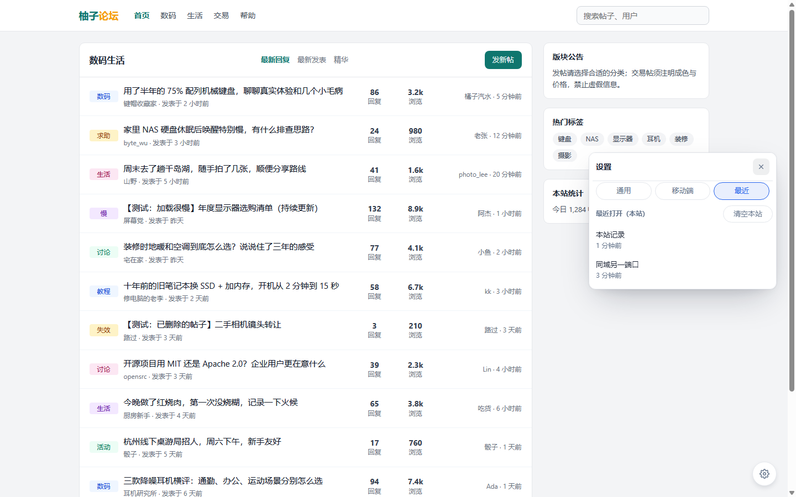
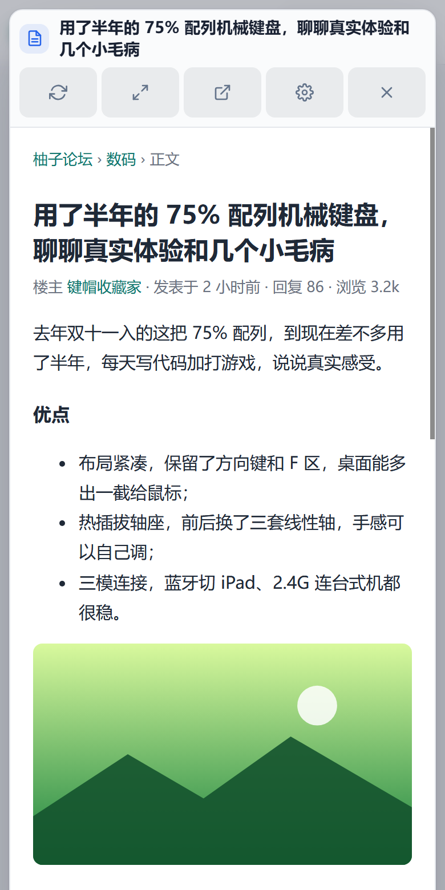

# Popup Viewer V2 · 页内弹窗打开新帖

[](https://github.com/coresZ/popup-viewer-v2.user/actions/workflows/ci.yml)
[](LICENSE)
[](CHANGELOG.md)
[](https://www.tampermonkey.net/)

> 点击论坛/帖子链接，不离开当前页面，在页内弹窗中阅读内容。

**Popup Viewer V2** 是一个 Tampermonkey 用户脚本。它拦截页面中的帖子链接，把内容加载到当前页面的弹窗里，支持多站点适配、任意网站链接规则、安全净化，以及桌面和移动端使用。

- 弹窗阅读，支持遮罩 / 悬浮两种驻留方式
- 内置 Discuz、淘股吧、linux.do、磁力站、X（Twitter）适配
- 任意网站可通过「点选链接」生成拦截规则
- 多种加载策略与安全沙箱，移动端触屏可用

## 截图

| 桌面弹窗 | 设置与最近记录 |
|---|---|
|  |  |

| X 阅读器 | 移动端 |
|---|---|
|  |  |

## 安装

1. 安装并启用 [Tampermonkey](https://www.tampermonkey.net/)（iOS 也可使用 Userscripts 等支持 `GM_*` API 的脚本管理器）。
2. 安装脚本：打开 [`dist/popup-viewer-v2.user.js`](https://raw.githubusercontent.com/coresZ/popup-viewer-v2.user/main/dist/popup-viewer-v2.user.js)，或在 Tampermonkey 管理面板中从文件导入。
3. 打开支持的站点，页面右下角出现 ⚙ 即表示安装成功。

## 支持站点

Discuz 系（`chiphell.com`、`wnflb2023.com`、`52pojie.cn`）、淘股吧（`www.tgb.cn`、`shuo.tgb.cn`）、`linux.do`、磁力站（`1cili.com`、`s.9cili.mom`）、X / Twitter（`x.com`、`twitter.com`）。其它网站可通过「链接规则」自行添加。

## 文档导航

| 文档 | 内容 |
|---|---|
| [用户使用手册](docs/user-guide.md) | 安装更新、弹窗操作、完整设置项、链接规则、X 阅读器、移动端、快捷键与故障排查 |
| [项目开发手册](docs/development.md) | 架构、构建、目录结构、加载策略、安全模型、扩展开发、测试与发布 |
| [文档索引](docs/README.md) | 全部文档导航 |
| [更新日志](CHANGELOG.md) | 各版本变更记录 |
| [贡献指南](CONTRIBUTING.md) | Issue / PR 流程、开发约定与测试要求 |
| [安全策略](SECURITY.md) | 漏洞报告方式与支持版本 |
| [第三方声明](THIRD_PARTY_NOTICES.md) | 第三方代码来源与许可 |

## 声明

- **许可证**：本项目采用 [MIT License](LICENSE) 开源。
- **第三方代码**：X 支持部分参考 / 改写自 [peek](https://github.com/DoraRabbitYan/peek)（MIT License），详见 [THIRD_PARTY_NOTICES.md](THIRD_PARTY_NOTICES.md)。
- **数据与隐私**：脚本没有自有服务器，设置、规则、历史与草稿均保存在浏览器本地；不会上传浏览数据。`@connect *` 仅用于抓取目标页面内容。
- **使用风险**：弹窗内容来自目标网站，请遵守对应网站的服务条款；「在 iframe 中运行」等高级选项请按需开启，风险说明见[用户使用手册](docs/user-guide.md)。

## 开发

```bash
npm install
npm run build
npm test
```

完整的构建、目录结构、扩展开发与发布流程见[项目开发手册](docs/development.md)。
