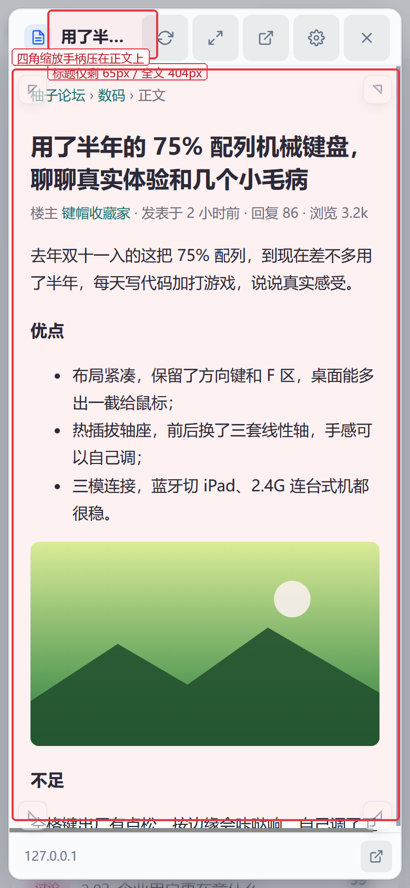
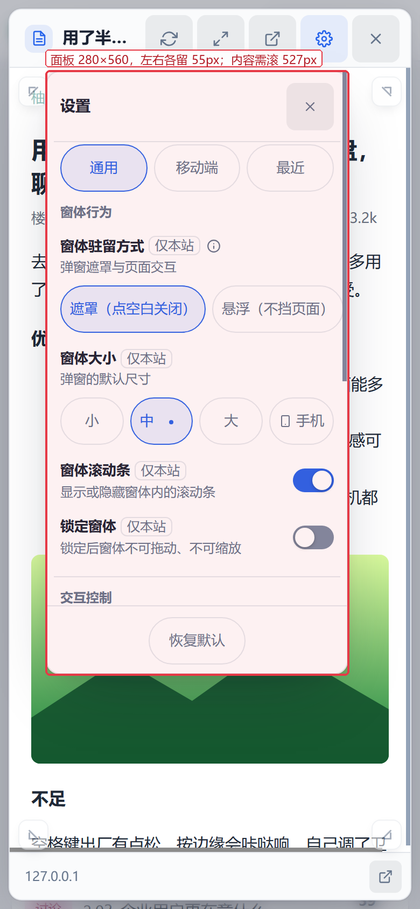
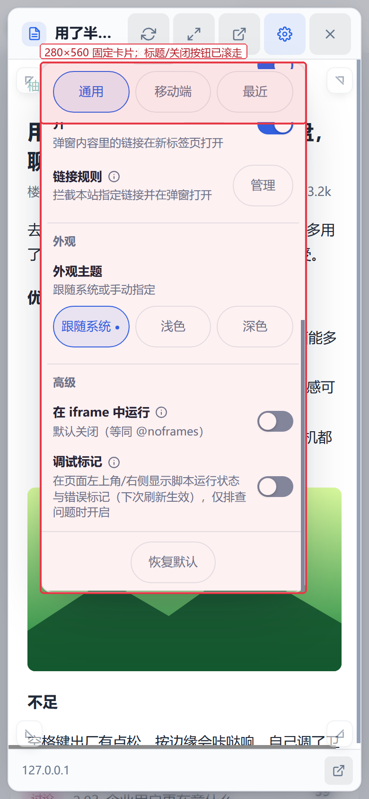
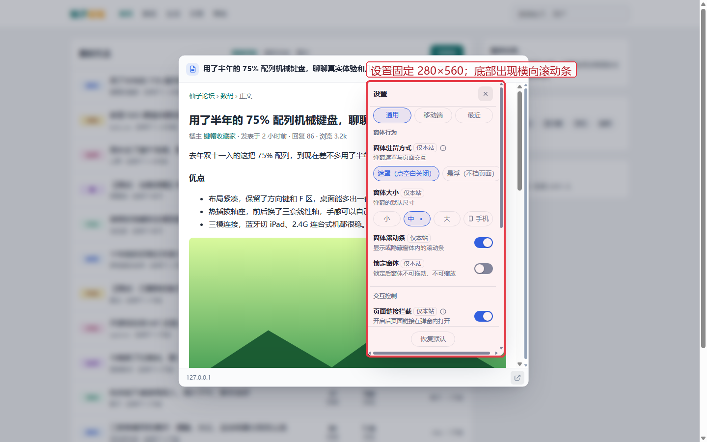
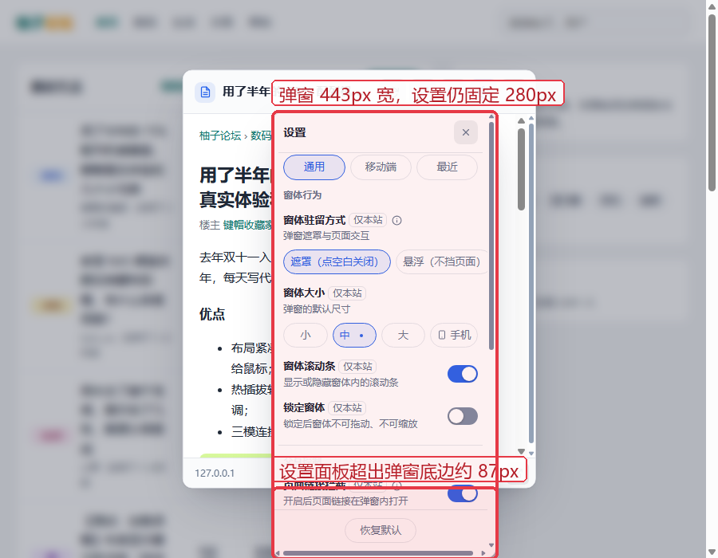
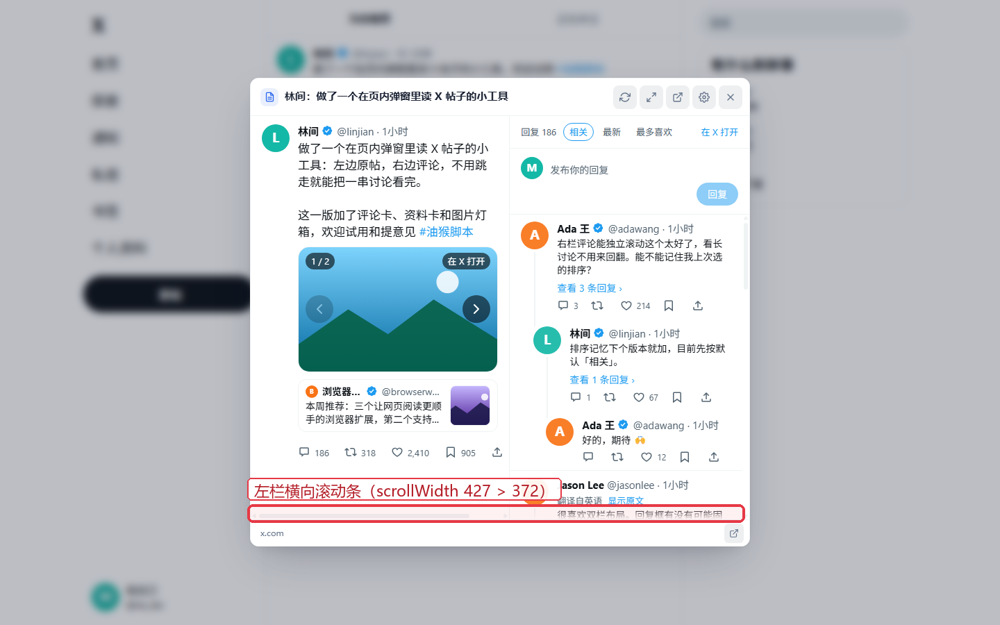
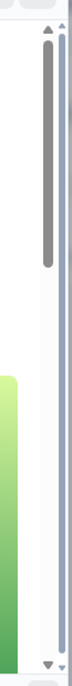
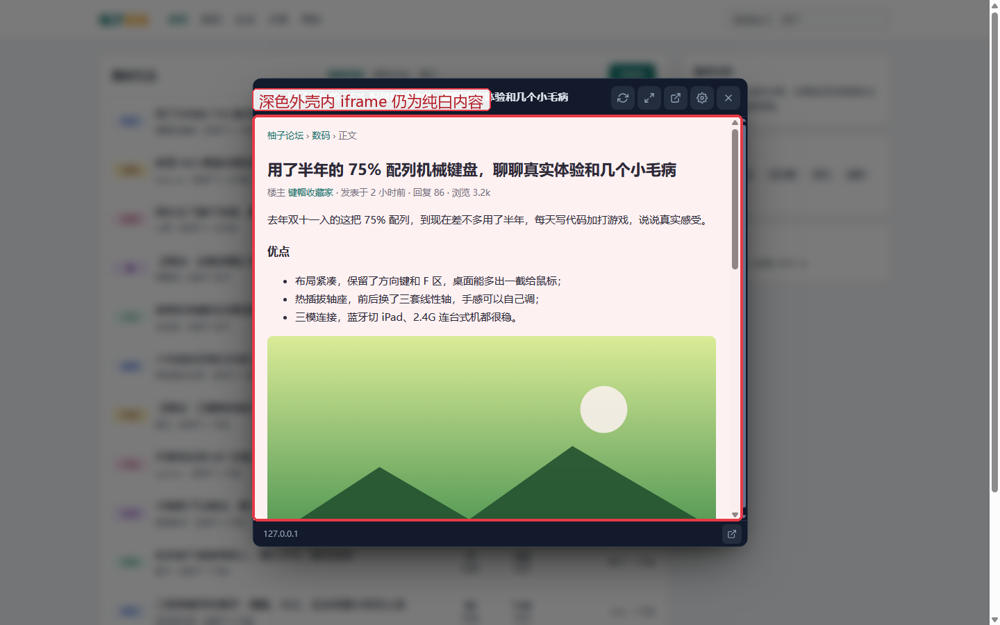

# UX 评审：交互与样式问题清单（v2.3.0）

> 时间：2026-10-30 · 视角：产品经理 + 视觉/交互设计
> 方法：无头 Chrome 实测（1440×900 / 1280×800 / 1024×768 / 900×700 / 800×600 桌面，390×844 触屏模拟）+ 源码核对
> 基线：当前工作区 v2.3.0（2.2.0 评审的阶段 1–5 修复已完成，未提交）
> 上轮评审：[review-ux-2.2.0.md](review-ux-2.2.0.md) · 修复记录：[plan-ux-fixes.md](plan-ux-fixes.md)
> 本轮修复状态：P1 及同批 P2 已在 2.3.1 落地，见 [plan-ux-fixes-2.3.1.md](plan-ux-fixes-2.3.1.md)
> 证据：截图在本目录 `review-assets-2.3.0/`；原始采集脚本与 JSON 在仓库外 `%TEMP%\dsh-ePaSbm\pv2-review2\`

## 结论

- **未发现新的 P0**；2.2.0 的键盘输入劫持、隐藏界面可聚焦、标题/后退、点选规则劫持、错误文案、慢加载提示、触屏热区、设置 Esc 等修复均未回退（见 `verify3.json`）。
- 仍有 **9 个 P1、14 个 P2**。核心问题集中在两处：**移动端外壳没有专门布局**，以及**设置面板仍是一张 280×560 的桌面浮窗**。其余是 X 阅读器横向溢出、iframe 双滚动条、规则面板焦点时序、X 链接对比度和产品信息架构。
- 视觉亮点：Shadow DOM 隔离生效；明暗主题令牌、焦点框、触屏 44px 热区整体达标；移动端点选确认 `mobile-picker-sheet.png` 与规则面板 `mobile-rules-sheet.png` 已经是全宽底部 sheet，是设置面板可以复用的正面样板。

---

## 1. 移动端外壳

### M1 · P1 · 5 个 44px 按钮把标题压到 65px【实测/截图】

- 现象：390×844 下弹窗 374×828，头部刷新/全屏/新标签/设置/关闭 5 个按钮均 44×44，标题文本可视宽度只剩 65px，r19 中只显示「用了半…」；完整标题宽 404px。320px 视口下标题空间趋近 0。
- 证据：`mobile-popup-header.png`；`measure2.json > mobile-popup` `titleW=65 / titleScroll=404`；`src/ui/style.css:1971-1974`、`style.css:367-417`。
- 影响：手机用户无法辨别当前帖子，长标题同前缀时容易点错；触屏没有 hover 可看 title。
- 建议：移动端头部改两层：第一行「favicon + 最多两行标题 + 关闭」，第二行 2–3 个主操作；刷新/新标签/设置收进「更多」菜单。去掉标题左侧 26px 装饰图标。

### M2 · P1 · 四角缩放手柄仍遮挡正文，44px 热区会拦截点击【实测/截图】

- 现象：手机端默认显示 4 个半透明缩放手柄（视觉 28×28），位置 `top:62px / bottom:46px`，正好压在内容区首行面包屑和末行正文上；`::before` 把热区扩到 44px，会抢走正文点击。r19 四角均可见，左下角压住「空格键出厂…」一行。
- 证据：`mobile-popup-header.png`；`measure2.json > mobile-popup.knobs` 四个角 (17,71)/(345,71)/(17,761)/(345,761)；`src/ui/style.css:302-350`；`SettingsManager.js` 默认 `mobileResize:true`。
- 影响：四角 44×44 范围内的链接/文字点不到，阅读时容易误触改变窗口大小；视觉上像四块污点。
- 建议：窄屏默认关闭；或只在长按/双指缩放意图时唤出；把手贴边做成 8px 细条并把热区朝窗体外部扩；至少为内容区留出 44px 安全边。

### M3 · P1 · 移动端设置仍是 280×560 居中卡片，滚动后标题/关闭按钮消失【实测/截图】

- 现象：390×844 下设置面板 280×560（x=43、y=66，左右各留 55px），内容 `scrollH=1085 / clientH=558`，需要滚 527px；滚到底时「设置」标题和 X 关闭按钮已完全滚出（`head=-454..-395`），只剩 sticky 的 3 个 tab；r28 顶部还能看到蓝色开关残片从 tab 行上方漏出。
- 证据：`mobile-settings-card.png`、`mobile-settings-scrolled.png`；`measure2.json > mobile-settings`；`probe3.json > mobile-sticky`；`style.css:517-523` 固定 `width:280 / max-height:560`；`PopupPanel.js:503-518` 只有上下都放不下时才走全屏分支，390×844 永远进不去。
- 影响：中文标签大量换行、一屏看不全；滚动后找不到关闭入口；内容穿透 tab 栏状态难判断。与「点选确认」「规则面板」的全宽 sheet 形成明显反差。
- 建议：移动端统一全宽 bottom sheet：`width:calc(100vw-16px)`、`max-height:min(88dvh,720px)`；标题+关闭固定、tab 吸顶且完全不透明、内容独立滚动；打开时从底部滑入，点遮罩关闭。

---

## 2. 设置面板

### S1 · P1 · 280px 固定宽导致横向滚动条，1003px 内容挤进 548px 视口【实测/截图】

- 现象：桌面设置 280×560；`clientW=268 / scrollW=275`，内层 pane `clientW=256 / scrollW=269`，r03/r05/r10/r14 底部都能看到一条贯穿的横向滚动条；通用页 `scrollH=1003 / clientH=548`，需滚约 1.8 屏。根因是「窗体驻留方式」两个分段按钮 `white-space:nowrap`，中文标签最小宽度超过 pane（按钮右缘 1023 > pane 右缘 1010，溢出 13px）。
- 证据：`settings-desktop-overflow.png`；`measure2.json > settings-desktop`；`probe3.json > settings-pane-overflow`；`style.css:517-524, 824-844`（`overflow-y:auto` 未约束 x，`.pv-seg-item` 不换行）。
- 影响：每次打开设置都像破版；可用宽度被横向条继续吃掉；中文长标签反复换行，扫描困难。
- 建议：桌面宽度提到 340–360px，或改成右侧 360px drawer；`overflow-x:clip`；「驻留方式」改纵向两项（标题 + 一句说明），不要用横向胶囊硬塞长文案；footer 去掉负 margin。

### S2 · P2 · 设置滚动结构：标题滚走、tab 上方漏内容、sticky footer 遮挡【实测/截图】

- 现象：桌面/手机滚到下方后「设置」标题和关闭按钮完全消失，只剩 tab；`style.css:532` 的 6px padding 让内容从 tab 上缘漏出；手机 sticky footer 高 62px，占掉 558px 可视区的 11%，「交互控制」标题刚好卡在 footer 上沿。
- 证据：`mobile-settings-scrolled.png`；`probe3.json > mobile-sticky`；`style.css:559-575`（head 非 sticky）、`873-880`（footer sticky）。
- 建议：head + tabs 合并为单一 sticky 头部（不透明 surface、底边框、滚动后加阴影）；滚动容器加 `scroll-padding-top`；footer 固定 48–52px 并加边框，内容底部留出等高 padding。

### S3 · P2 · 信息架构不均衡，「最近」藏在设置里，作用域徽标噪声大【实测/截图】

- 现象：通用 tab 仍有 1003px 内容，移动端 tab 只有 2 项（四角把手、惯用手），最近 tab 是历史记录而非设置；「仅本站」徽标在通用页出现 6 次；「恢复默认」常驻所有非最近 tab。
- 证据：`settings-desktop-overflow.png`；`r04-settings-mobile.png`、`r24-recent.png`；`SettingsPanel.js:330-440`；`style.css:873-880`。
- 建议：改单页可折叠分组 + 搜索；移动端两项并入「窗体行为」；「最近」提升为齿轮菜单/工具栏的独立入口；作用域改成分组标题图例；恢复默认下沉到「高级」折叠区。

### S4 · P2 · 设置面板与弹窗的边界错位，800px 时盖住弹窗头【实测/截图】

- 现象：1280 视口 popup y100–700，settings y153–713（超出 13px）；1024 超出 37px；900 超出 87px；800 时设置被顶到 y8–568，直接盖住弹窗标题栏和右上按钮。手机则是 280 居中卡（见 M3）。
- 证据：`settings-overflow-popup-900.png`；`resp5.json` 全部 rect；`PopupPanel.js:483-528` 定位逻辑。
- 建议：定义响应式矩阵：≥1200 用 360px 侧栏贴右、高度与弹窗对齐；900–1200 用 340px 右侧抽屉并限制在视口；<900 全高右侧 drawer；<560 全宽底部 sheet。不要让 280px 浮窗在 800px 视口里自由漂。

---

## 3. 浮层与可访问性

### R1 · P1 · 规则面板打开后焦点留在背后弹窗，且没有 focus trap【实测+代码】

- 现象：`visible=true` 时 `document.activeElement` 仍是背后的 `#popup-panel-settings`；继续 Tab 的前 5 个焦点是「弹窗关闭 → iframe ×4 → 页脚链接」，第 7 个才到规则面板「全部站点」。关闭也不归还焦点。
- 证据：`focus4.json > rules-open-state / rules-initial-focus / rules-tab-seq`；`RulesPanel.js:66-72` 在 `classList.add('visible')` 后立刻 `closeBtn.focus()`，但 `PopupPanel.js:154,766-776` 的 `_syncInert` 用 MutationObserver 异步才把 `root.inert=false`，此时焦点落在 inert 子树，focus() 静默失败。
- 影响：键盘用户打开规则后实际停在弹窗外层，按 Enter 可能误触背后按钮；读屏读不到规则内容；核心管理流程不可用。
- 建议：`open()` 先同步 `root.inert=false` 再 focus（或等下一帧）；记录触发按钮并在 close 时还原；加 Tab 循环和 `aria-modal="true"`。

### R2 · P2 · ARIA / 读屏语义缺口【代码】

- 现象：`#popup-settings-popover` 是裸 `div`，无 `role` / `aria-label`；tablist 只有 `role=tab`，pane 无 `role=tabpanel` / `aria-controls`，也没有方向键和 roving tabindex；规则/点选确认 `role=dialog` 均无 `aria-modal`；picker 提示条 `role=status`，鼠标划过每个元素都改文案，读屏可能连续播报。
- 证据：`SettingsPanel.js:394-415,442`；`RulesPanel.js:37`；`ElementPicker.js:35,54,186`；`PopupPanel.js:124`。实测 `probe3.json > settings-tab-walk` 显示 Tab 会从设置控件逃到宿主 `.thread-title` 链接。
- 建议：设置浮层加 `role=dialog aria-label="设置"`（非模态可不加 aria-modal，但要有焦点归还）；tabs 补 `aria-controls`/`tabpanel`/`aria-labelledby`/方向键；规则与 picker 确认补 `aria-modal`；picker 的 hover 文本 `aria-live=off`，只在确认态播报。

---

## 4. X 阅读器

### X1 · P1 · 左栏固定横向滚动条，内容超出 55px【实测/截图+代码】

- 现象：双栏 718px 下左栏可见 372px，但 `scrollWidth=427`（多 55px），r22/r23 左栏底部整条横向滚动条；浅色/深色均复现。根因是操作栏 `.pv-x-actions` 6 项 `gap:22px`，内容 359px 塞进 288px 主栏，最后「浏览」按钮被推到右栏下方。
- 证据：`x-reader-overflow.png`；`measure2.json > x-geometry` `.pv-x-pane-post clientW=372 / scrollW=427`；`xact8.mjs` 实测 `.pv-x-actions clientWidth=288 / scrollWidth=359`，6 个子项实际右缘到 788 > 栏右 733；`style.css:2069-2073` 只写 `overflow-y:auto`，`style.css:2329-2336` gap 22px。
- 影响：帖子操作栏被裁切，分享/浏览按钮可能点不到；双栏像没对齐的表格；用户会误以为可横向拖动。
- 建议：`overflow-x:clip`；操作栏 `justify-content:space-between` + `gap:8px` + `min-width:0`；给 `.pv-x-main`、引用卡、媒体容器补 `min-width:0`；在 720/1036/390 三档加 `scrollWidth<=clientWidth+1` 断言。

### X2 · P1 · 浅色主题链接/按钮对比度仅 3.0:1（11 处）【实测】

- 现象：`#1d9bf0 on #ffffff = 3.0:1`：17px 话题、14px 提及/「查看 N 条回复」、13px 排序/「在 X 打开」/「显示原文」，以及白字 `#fff on #1d9bf0` 的 14px 回复按钮；均低于 AA 4.5:1（17px 非粗体不属大文本例外）。
- 证据：`measure2.json > x-contrast`（11 条 cr:3）；`src/x/xTheme.js:10` `ACCENT='#1d9bf0'`；`style.css:2172-2175,2300-2302,2419-2421,2500-2512,2540`。
- 影响：长回复里的「查看 N 条回复」几乎看不见；白字按钮发虚；低视力用户和低质量屏幕可读性差。
- 建议：拆分 `--pv-x-accent-text`（浅色 #0b6bcb 约 5.2:1，深色保留 #1d9bf0）、`--pv-x-accent-fill`（按钮底 #0f6fbf，白字约 5.4:1）、`--pv-x-on-accent`；`#1d9bf0` 只给图标、焦点环和非文字装饰；正文链接加下划线作为非颜色线索。

### X3 · P1 · 回复草稿只存内存，整页刷新/关标签即丢【代码】

- 现象：弹窗内关闭、点刷新可恢复；整页刷新、关闭浏览器标签或崩溃直接丢失，无确认、无提示。
- 证据：`src/x/xDrafts.js:3` 明确「只存在模块内存里（页面刷新会丢）」；`XThreadLoader.js:783-796` 只从模块级 `replyDrafts` 恢复；全项目无 `beforeunload` / 持久化。
- 影响：写长回复时刷新或误关标签会丢全部内容，属数据丢失。
- 建议：`GM_setValue` 按 tweetId 持久化（防抖、最多 20 条、7 天过期）；`beforeunload` 有草稿时提示；发送成功后清空。

### X4 · P2 · 右栏密度与滚动反馈偏弱【实测/截图】

- 现象：右栏 345px，可视 440px / 内容 1904px（约 4.3 屏）；回复行距 10px、正文 14/19，底部只有 14px 渐隐；滚动条 thumb 用 `--pv-x-border`（浅 #eff3f4 on #fff ≈1.05:1），基本不可见；最后一条被硬切。引用卡缩略图 56×56 偏小。
- 证据：`r22-x-light.png`、`r23-x-dark.png`；`measure2.json > x-geometry`；`style.css:2110-2130,2144-2156`。
- 建议：新增 `--pv-x-scrollbar`（浅 #a9b4c0、深 #4a5568），8px 圆角；回复行 padding 10→12、正文 15/20；分隔线全宽、滚动时工具行加阴影；渐隐 14→24px；引用缩略图 64×64。

### X5 · P2 · 排序只作用于已加载回复，文案像全局排序【代码】

- 现象：「最新 / 最多喜欢」只对当前已加载的十几条本地排序；「加载更多」追加后继续本地重排，不使用 X 服务端排序参数。
- 证据：`XThreadLoader.js:401-408,716-745`；`xRender.js:1024-1029`。
- 建议：接服务端排序；短期不能时文案改「已加载内排序」并标注「本地」，或排序时重新请求首页数据。

---

## 5. 弹窗外壳与视觉系统

### V1 · P1 · iframe 模式双层竖向滚动条【实测】

- 现象：r02/r13/r17 右侧同时出现 iframe 自身滚动条和外壳 `#popup-content-area` 的细滚动条；实测内容区 `clientH=581 / scrollH=587`，iframe `display:inline` + baseline 间隙造成 6px 溢出，两条滚动条同时存在。
- 证据：`double-scrollbar-crop.png`（右侧两条滚条并排）；`scroll9.mjs` 输出 `area.clientH=581/scrollH=587`、`iframe.display=inline`；`style.css:479-490,1765-1771`。
- 影响：右侧 16px 被两条滚条吃掉；滚轮落点不可预期；深色下白色 iframe 滚动条更突兀。
- 建议：`#popup-panel-iframe{display:block}`；`.iframe-direct-load{overflow:hidden}`，确保 iframe 高度 100% 且外壳不滚动；把「一个滚动所有者」写进组件规范，分别断言 iframe/解析两种渲染。

### V2 · P2 · 深色主题下 iframe 内容仍纯白【实测/截图】

- 现象：深色弹窗 header/footer 已是 #121a2b/#0f172a，内容区却为纯白 iframe + 白色滚动条，约 15:1 亮度断层；X 阅读器（r23）能完整变暗，说明主题能力存在，但 iframe/网页渲染路径没接上。
- 证据：`dark-popup-white-iframe.png`；`r14-dark-settings.png`；`style.css:143-165,1765-1770`；`color-scheme:light dark` 仅作用于外壳。
- 建议：same-origin iframe 注入 `color-scheme:dark` / `prefers-color-scheme` 覆盖，或渲染模板写 `<meta name="color-scheme" content="dark">`；设置增加「内容配色：跟随主题/保持原网页」；不能改内容时至少让 iframe 滚动条和背景进入深色。

### V3 · P2 · 加载/错误态留白过大，慢加载布局抖动【实测/截图】

- 现象：r11 加载态 718×581 内容区只有 38px spinner + 15px 标题 + 13px 副标题，约 90% 空白；3 秒后直接把副标题换成「还在加载，网站响应较慢」并 append 按钮，没有预留高度，文字和按钮跳动。r12 错误态 52px 图标 + 17px 标题 + 13px 说明 + 36px 按钮，整组约 200×200 悬在中央，404 只有一个主按钮。
- 证据：`loading-state.png`、`error-state.png`；`Loading.js:6-30`、`ErrorView.js:25-50`；`style.css:1635-1758`。
- 建议：加载用骨架（标题条 + 3 行正文条 + 16:9 媒体占位）+ 域名/已等待秒数；3 秒提示固定高度、按钮位置预留。错误卡限 360–400px，图标 44px、标题 18px、说明 14px；有重试时「重试」主按钮 +「新标签页」次按钮；404 加「复制链接」文字按钮。

### V4 · P2 · 组件尺寸/圆角/动效缺少统一规范【代码+截图】

- 现象：按钮高度至少 6 档（header 34 / footer 28 / settings close 30 / rules close 30 / settings tab ~30 / picker ~27 / error 36）；圆角 8/10/12/14/16/999 混用；动效时长 80–300ms 散落，`--pv-dur-1/2/3` 只覆盖一部分；规则面板硬编码另一套字体栈和 14px 圆角。
- 证据：`style.css:427-428,623-624,1015-1037,1774-1787,1811`。
- 建议：建立组件规范：图标按钮 32/36（触屏 44 热区），文字按钮 32，标签页 32，页脚 30；圆角 6/8/12；字体 12/13/14/15/17；动效 120/200/280ms，关闭比打开快 40–60%；规则面板复用设置令牌。

### V5 · P2 · 标题/页脚/最近列表信息密度低【截图】

- 现象：标题左侧是通用文档图标而非站点 favicon；页脚 38px 只放 12px 域名 + 28px 外链图标，与 header 的「在新窗口打开」重复；最近列表 r24 280×196 只有一行文本，无 favicon/缩略图；空状态只有一行灰字；全屏 r17 媒体可达 1188px 宽，缺少阅读列上限。
- 证据：`r02-popup.png`、`r16-float.png`、`r17-fullscreen.png`、`r24-recent.png`；`style.css:392-402,1774-1787,931-958`。
- 建议：标题用站点 favicon + 回退字母图标；页脚改为「域名 + 阅读进度/外链」轻量状态条；最近列表加 favicon/时间/悬停操作；全屏内容设 760–820px 阅读列上限，媒体 `max-width:100%` 居中。

---

## 6. 产品机会

### P1 · P2 · 最近列表信息量低，清空不可撤销【截图+代码】

- 现象：条目只有单行截断标题 + `host · 相对时间`，同一前缀帖子无法区分；没有条目级删除、没有「在新标签页打开」；「清空」两次点击后立即清空全部记录，无撤销。
- 证据：`r24-recent.png`；`SettingsPanel.js:330-391`；`style.css:944-948`。
- 建议：两行标题 + 站点图标 + 时间分组；条目 hover 提供「新标签打开/删除」；清空后 toast「已清空 · 撤销」4 秒（复用规则删除的 undo）。

### P2 · P2 · 无规则站点首次使用无引导，核心功能静默失效【代码】

- 现象：没有内置 adapter 的网站点击普通链接既不打开弹窗也不提示；唯一入口是右下角齿轮（只有 hover 的「脚本设置」title）。添加第一条规则需 6 步：设置 → 滚动找「链接规则」→ 管理 → 点选链接 → 页面点选 → 确认。
- 证据：`main.js:26-32` 只注册 5 类 adapter；`SiteManager.js:53-54` 未匹配返回 null；`SettingsPanel.js:425-428` 把链接规则埋在通用 tab 下方；`r01-forum.png` 只有齿轮。
- 建议：首次进入未知站点给一次非阻塞提示「本站还没有规则，点这里点选第一条链接」；齿轮加红点/徽标；「链接规则」提到设置首屏；README 和油猴菜单突出「在此站点点选链接」。

### P3 · P2 · 点选候选仍有两个同名「只拦截这类链接」，无法区分【截图】

- 现象：r09 确认框中两个候选都写「只拦截这类链接 本页 12 个 / 18 个」，只有展开「高级」才能看到原始选择器；触屏没有 hover 看 title，用户不知道差异。
- 证据：`r09-picker-confirm.png`；`ElementPicker.js` 候选渲染；`verify3.json > picker-cands-distinct`。
- 建议：用页面结构描述（如「帖子标题链接」「版块内全部链接」）+ 命中示例缩略；原始选择器收进「高级」；选中候选时在页面上高亮所有命中（已有），并显示 1–2 个示例文字。

### P4 · P2 · X 阅读器分栏比例固定 50/50，缺少密度预设【代码+截图】

- 现象：左/右栏按 1.04/0.96 固定，无法拖动；长帖/多图时左栏媒体与右栏文本都拥挤；排序、加载更多、卡片浮层仍互相干扰（X10–X12 部分已修）。
- 建议：可拖拽分隔并记住比例（默认 45/55）；提供「专注原帖 / 专注回复 / 舒适 / 紧凑」密度预设；加载更多显示进度和手动按钮。

---

## 7. 建议的修复顺序

1. **P1 移动端外壳**：M1/M2/M3 一次做（头部重构 + 设置底部 sheet + 手柄默认关闭）。
2. **P1 设置桌面布局**：S1/S4 一起（340–360px drawer + `overflow-x:clip` + 断点矩阵）。
3. **P1 可访问性**：R1（规则面板 inert 时序 + focus trap + 焦点归还），R2 作为同批。
4. **P1 阅读器**：X1（操作栏 gap/min-width）、V1（iframe 单一滚动所有者）、X2（X 链接对比度令牌）。
5. **P2 打磨**：S2/S3、V2–V5、X3–X5、P1–P4 按迭代排。

## 8. 验收清单（建议加入回归）

- 1440 / 1280 / 1024 / 900 / 800 / 560 / 390 七档宽度 × 明暗主题截图；每档断言 `scrollWidth <= clientWidth + 1`。
- 移动端标题最小可见宽度 ≥160px；5 个动作按钮不挤压标题；四角手柄默认不遮挡内容。
- 设置面板：无横向滚动条；head+tabs 始终可见；footer 不遮挡内容；切 tab 高度不跳。
- 规则面板：打开后 activeElement 在面板内；Tab 循环不逃逸；Esc 关闭后焦点回到触发按钮。
- X 阅读器：720/1036/390 三档左栏无横向滚动；链接对比度 ≥4.5:1；回复草稿刷新后可恢复。
- iframe 模式：只出现一条竖向滚动条；深色主题下内容加载前后不闪白、滚动条不刺眼。
